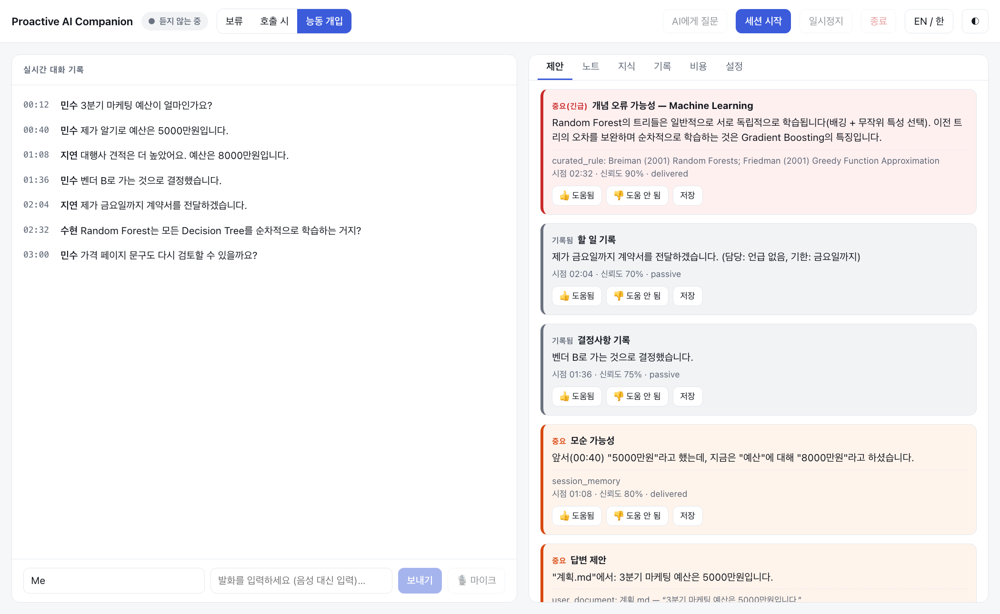
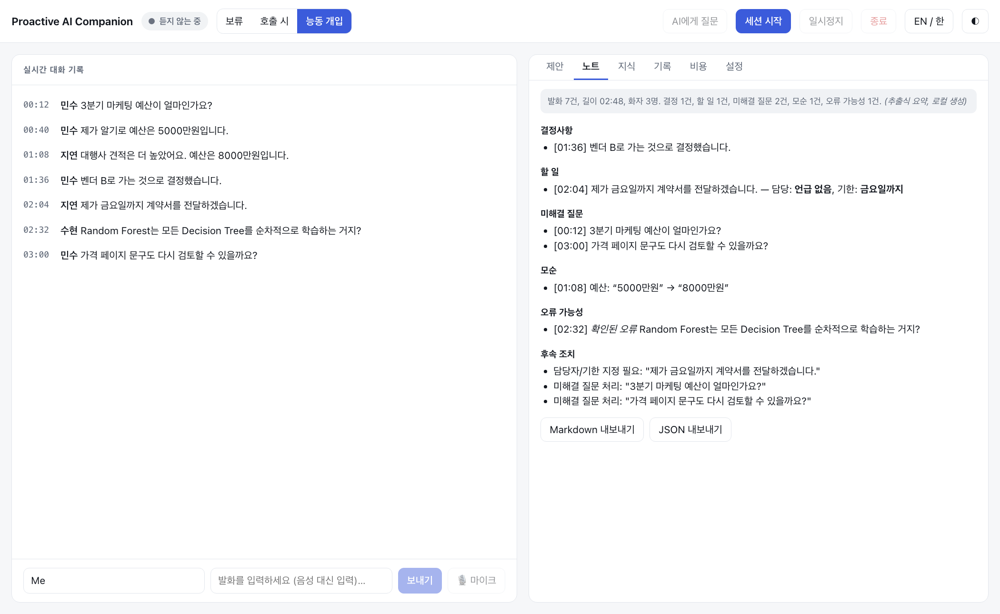

# Proactive AI Companion (가칭 — 상표 충돌 확인 전)

[English](README.md) | **한국어**




*스크린샷은 `scripts/seed_demo.py`로 만든 가상의 안전한 데모 데이터이며 실제 대화가 아닙니다.*

회의·공부·업무 중 사용자가 명시적으로 켠 세션 동안 대화를 듣고, **묻기 전에 먼저 도와주는** 동반자입니다. 질문, 개념 오류, 앞뒤가 안 맞는 말을 감지해 보류 카드, 호출 시 답변, 능동 개입 중 하나로 보여 주며, 모든 개입은 사용자가 정한 정책 조건을 통과해야 합니다.

**상태: Phase 1 수직 슬라이스 + Phase 2 일부.** 구현된 것과 아닌 것은 [docs/DEVELOPMENT_ROADMAP.md](docs/DEVELOPMENT_ROADMAP.md)에 정확히 정리했습니다(문서 본문은 영어).

## 실행
```bash
pip install -r requirements.txt
./run.sh                 # http://127.0.0.1:8787  (PORT=로 변경)
python3 -m pytest -q     # 테스트 38개
python3 eval/run_eval.py # 소규모 수작업 라벨 평가
```
API 키가 없어도 규칙 + 내 문서 검색만으로 오프라인 동작합니다. 음성 인식은 **브라우저 Web Speech API**(Chrome/Safari, 브라우저 제공사가 클라우드에서 처리할 수 있음) 또는 텍스트 입력을 사용합니다. LLM 연결은 선택 사항이며 [docs/DEPLOYMENT.md](docs/DEPLOYMENT.md)를 참고하세요.

## 동작하는 기능 (docs/TEST_RESULTS.md에서 검증)
동의 후에만 세션 시작 · 일시정지/재개/종료 · 실시간 대화 기록 · 질문 감지(영어/한국어, 수사적·확인형 질문 제외) · 큐레이션된 개념 오류 5개 규칙(데모 지식) · 수치 모순 감지 · 수치 주장 vs 내 문서 비교("확인 필요"로만 표시, 확정 오류로 단정하지 않음) · 보류 / 호출 시 / 능동 개입 3가지 모드와 정책 엔진(임계값, 쿨다운, 최대 횟수, 방해 금지, 중복 억제, 사용자가 말하는 중에는 끼어들지 않음) · 소크라테스 모드 · 결정사항/할 일(담당자·기한은 발언에 있을 때만) · 타임스탬프가 연결된 요약 · SQLite 기록, 검색, Markdown/JSON 내보내기, 삭제 · 선택적 음성 저장 · 비용/지연 패널 · 영어/한국어 UI.

## 아직 안 되는 것
화자 분리 · 서버/오프라인 음성 인식(faster-whisper) · 시스템 오디오 및 Zoom/Meet/Teams 수집 · Tauri 데스크톱 앱, 트레이, 설치 파일 · 웹 검색 및 키워드 이상의 RAG · LLM 요약 · PDF 내보내기 · 저장 시 암호화 · 호출어 · 커넥터. 클라우드 LLM 제공자는 구현돼 있지만 **실제 API로는 테스트하지 않았습니다.** 한국어는 문장 길이가 길어지면 질문-문서 검색 정확도가 떨어지는 한계가 있습니다(글자 2-gram 겹침 기반).

구조: `app/`(이벤트, 정책, 엔진, 제공자, 저장소, API) · `static/index.html` UI · `tests/` · `eval/` · `docs/`.
