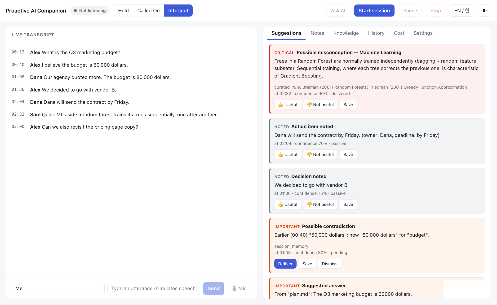
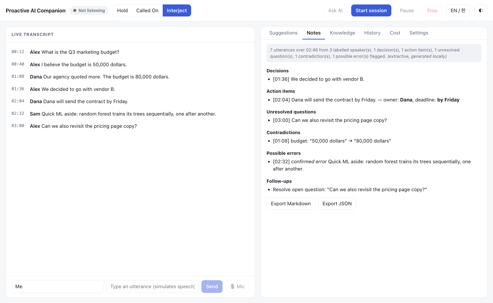

# Proactive AI Companion (working name — trademark check pending)


An always-on (per explicit session) companion that listens during meetings, study or work and **helps before you ask**: it detects questions, misconceptions and contradictions, and surfaces them as Hold cards, on-demand answers, or live interjections — under policy gates you control.

**English** | [한국어](README.ko.md)




*Screenshots use safe, made-up demo data (`scripts/seed_demo.py`), not real conversations.*

**Status: Phase 1 vertical slice + parts of Phase 2.** See [docs/DEVELOPMENT_ROADMAP.md](docs/DEVELOPMENT_ROADMAP.md) for exactly what is and isn't built.

## Run
```bash
pip install -r requirements.txt
./run.sh                 # http://127.0.0.1:8787  (override with PORT=)
python3 -m pytest -q     # 38 tests
python3 eval/run_eval.py # small hand-labelled eval
```
No API key needed: rules + retrieval over your own documents work offline. Speech-to-text uses the **browser's Web Speech API** (Chrome/Safari; may be cloud-processed by the browser vendor) or typed input. Optional LLM: see [docs/DEPLOYMENT.md](docs/DEPLOYMENT.md).

## What works (verified — see docs/TEST_RESULTS.md)
Consent-gated session start · pause/resume/stop · live transcript (browser STT or typed) · question detection (EN/KO, ignores rhetorical/tag questions) · curated misconception detection (5 rules, demo KB) · numeric contradiction detection · numeric claims vs your documents ("needs verification", never "confirmed") · Hold / Called On / Interject with policy engine (threshold, cooldown, max interruptions, DND, duplicate suppression, no interjection while user speaks) · Socratic mode · decisions/action items (owner/deadline only if stated) · extractive summary linked to timestamps · SQLite history, search, Markdown/JSON export, delete · optional audio save · cost/latency panel.

## What does NOT work yet
Speaker diarization · server-side/offline STT (faster-whisper) · system-audio / Zoom / Meet / Teams capture · Tauri desktop shell, tray, installer · web search / RAG beyond keyword overlap · LLM summaries · PDF export · at-rest encryption · wake word · connectors · MISSING_INFORMATION / LEARNING_OPPORTUNITY / FOLLOW_UP events. Cloud LLM providers are implemented but **untested against a live API**.

UI languages: English and Korean (header toggle `EN / 한`; `?lang=ko`). Companion-generated text follows the session language; the Markdown export headings are still English.

Layout: `app/` (events, policy, engine, providers, storage, API) · `static/index.html` UI · `tests/` · `eval/` · `docs/`.
